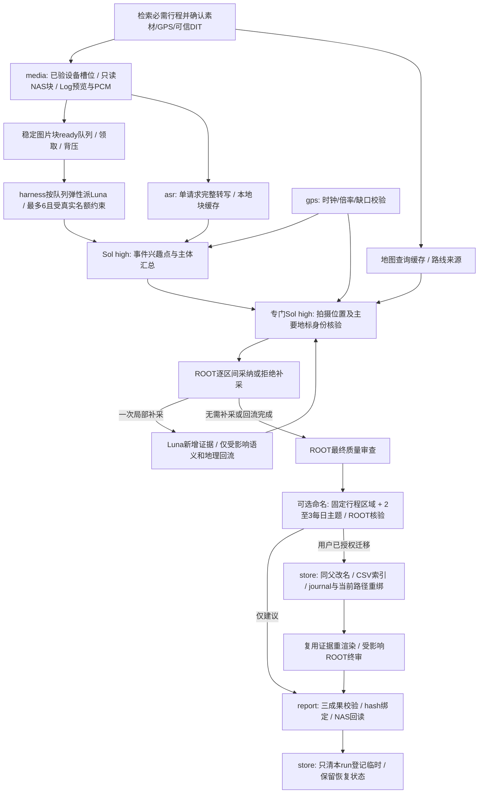

# 架构与可靠性边界

## 数据流与职责

保持六模块及薄CLI：`media`负责探测、实际PTS抽样、硬件回退、本地WAV拼切；`gps`负责官方FIT解码、轨迹断点/停留与可信关联；`asr`负责HTTP完整消费、服务锁与未知状态gate；`analysis`负责包/schema/证据归属/补采区间；`store`负责SQLite、JSON原子替换、锁和清理；`report`负责覆盖统计、三文件依赖摘要和发布回读。CLI只协调这些步骤，不调用模型API。

每个媒体任务直接读取一个≤5分钟NAS源块，可同时产出JPEG与PCM；ASR从本地PCM取30秒片，保留1秒上下文。媒体槽位默认保守单路，多路须导入本机固定工具验证报告；不能由GPU型号或利用率推定路数。协调器是manifest/SQLite唯一写者，媒体/ASR worker只返回结果。ASR始终1请求，独立服务锁和unknown gate不变。ready/在途/派生磁盘阈值控制新任务提交，满时排空已提交并保存背压原因，不截断覆盖或提前清未发布证据。

v0.1.4新运行使用`block_visual_v1`：完整稳定块先生成纯视觉包，不等ASR；Luna只记录逐图事实，Sol日汇总仍读取全部适用音频的完整转写。旧运行缺省legacy，保留既有包/缓存，不在续跑时自动换模式。Luna由harness按ready队列弹性派发，积压最多6，少包少开；实际受当前宿主空闲名额约束，并保留Sol所需名额。脚本只提供队列/领取/建议数据，不spawn Agent；领取小状态与长媒体命令的总锁分开，不能成为第二个manifest写者。细节见[并发约定](concurrency.md)。没有后台服务或独立调度平台。

新运行的`select_first_v3`在硬件帧下载前筛选所需帧，仍解码整个块并校验实际PTS/预览；v3独立缓存身份，旧run缺字段保持version2。每源ASR片可因块完成次序而先后就绪，但协调器最终按时间排序完整转写，不将完成顺序当拍摄顺序。具体硬件实测和非端到端性能边界见并发约定。

## 状态、身份与恢复

`manifest.json`保存run身份、源清单/大小/mtime、侧车SHA256、计划/成功帧/包/转写/临时登记；`state.sqlite3`保存按内容摘要命名的阶段结果。成功缓存只有派生物存在时才复用，成功ASR缓存不再次提交。单文件JSON写临时文件后替换，SQLite单条提交；二者不是跨文件事务，恢复时由缓存补回manifest。源视频身份采用大小和mtime（不读取整片计算hash）；侧车另有hash。该方案不能发现有人保持大小与mtime同时篡改原片的情形。

状态含义：`partial`仍有计划/ASR/视觉/已采纳补采/日汇总待完成；`complete`所有来源覆盖完成；`terminal_with_gaps`全部可读来源完成，但明确有不可读源损坏。不能把服务unknown、待包、缺抽当作终结缺口。`paused`/`paused_error`保留原state续跑，禁止重新init覆盖。

新增GPS或确认其随行意义时，可用`gps-review-package`建立独立manifest关联字段和Sol定向修订包；它复用原frame_id、既有包身份及转写，不重新抽样、看图或调用ASR。旧已发布三成果在state保留revision回滚副本，新版本使published_verified失效，必须重新ROOT审阅、绑定三文件hash并发布回读。细节见[接口约定](interfaces.md)。这是同一CLI内的数据修订层，不新增模块或服务。

同服务按规范化URL建立机器本地OS锁，持锁直至请求消费结束。上传后超时、断流、无终止记录、未知5xx均阻断后续提交。另一个chat/Client也不能绕过gate。进程死亡后OS锁释放，但inflight记录继续阻断，必须有外部结束证据才acknowledge。此锁只协调同一操作系统用户/机器上的客户端；多机器访问同ASR服务需在服务端另外限制，不能声称有全网络互斥。

## 信任与质量

模型输出是不可信候选。Pydantic检查结构；程序检查包全部图片、核心帧观察、合法源/时码/证据、GPS逐字引用、daily跨源引用。结构通过不证明语义正确；Luna仅逐图记录，Sol high跨帧/跨文件/转写/GPS汇总，ROOT审阅最终语义并独占基于较强错漏证据的定向补采决策。不能让模型候选自动触发NAS读取。补采按采纳区间扩前15秒/后30秒、合并并每秒采样，只一轮。

ROOT最终审查必须综合行程、GPS路线/停留、时间/播放倍率、视觉主体/地标、原始音频转写与地图证据，核对事件兴趣点的错漏、来源归属、时空矛盾和补采需求；不是格式检查。固定审查记录保存各维度证据摘要、问题/处理结论和有依据的剩余未知，并绑定输入及当前成果摘要。未审、未处置的实质blocking问题或审后输入变化均阻止approve/publish。脚本只检查记录/绑定，不能代替ROOT理解证据；无需新增用户确认或身份认证系统。

v0.1.1把有来源的行程作为最终必需输入，harness先检索本项目聊天/Notion。日级事件/兴趣点和主要视觉主体后另派专门Sol high关联时间、GPS、路线与地图缓存；对视觉重心地标/自然景观另做关键帧、可用朝向和地形资料的专项身份核验，给候选及缺证据。程序逐finding对账、绑定daily/行程/地图/GPS摘要；ROOT统一决定补采，一轮局部回流只更新受影响依赖。输入变化使旧地理结果/批准失效。近似推断独立geography，不修改原GPS-only location。媒体按可信DIT设备+模式显式LUT生成Rec709预览，变换hash参与缓存，缺LUT标未归一化。所有升级留在原六模块中，无新增GIS框架或服务。

补采候选可来自可见动作/跨帧矛盾、转写语义与画面的错漏线索，以及可靠时间对齐的GPS停留；先重用现有证据加强分析，仅较强错漏证据支持的具体区间才交ROOT采纳。转写回述可能谈过去或未来，不当作话语时刻现场发生；30秒片段精度不能假装词级事件定位。用户为本次行程提供GPS即确认随行，不反复询问或要求同行参数；只有明确不同人/日期等冲突才澄清。GPS停留仍须相机时钟/播放倍率可信，缺口不关联。没有独立关键词或停留自动触发框架，不对所有事件或停留一律补采。

时间使用原片内相对秒及实际解码PTS；未确认时区/正常播放倍率时不能宣称真实拍摄时刻。GPS只表示记录者或相机位置；不跨120秒轨迹缺口、不外推、不猜景物坐标。均匀10秒粗扫可能遗漏间隙短瞬间，无按天/帧数/token总预算截断。

## 文件与提交边界

原片、既有SRT/XML/FIT只读。活跃state与temp必须在本地非同步目录，且在源树以外。最终仅三文件写原源目录：音频JSON→事件JSON→Markdown。每文件同目录暂存、SHA256回读、替换；Markdown最后作为组提交标记。三文件共享run_id及依赖摘要，不具有三文件整体原子性。未知同名文件拒绝覆盖；源/侧车变化拒绝发布。

发布回读成功且状态可终结后，只删除本run登记的临时文件；清理逐项校验路径位于run根内并拒绝符号链接/目录联接。保留本地manifest、SQLite、已导入小结果和发布记录。不要将run、媒体缓存、服务gate、私有主机地址放入可分发Skill包。

每日命名是原六模块内的可选路径操作，不改变原片内容。主行程区域显式配置并绑定当前行程，Sol从已审证据选2–3个主题，ROOT核验；固定`naming-plan/review/apply`和边界、恢复细节见[命名约定](naming.md)。计划默认dry-run，apply须在用户当前授权内。只支持受控根内同父重命名与已识别CSV路径字段同步，journal保存阶段；保留源/帧/包/转写/缓存身份，历史包路径不改，manifest当前物理路径另行重绑。实际迁移使旧批准/已发布标记失效，必须重渲染并审查受影响发布依赖；不重跑媒体或模型。对本地manifest、CSV和目录移动不宣称跨文件事务，失败用原计划/journal恢复，冲突停止。

## 验证范围与限制

验证环境为Windows/Python 3.12及指定FFmpeg构建，其他平台代码路径未实测。合成回归测试不能证明任意相机/字幕/ASR协议兼容；设备识别只涵盖已支持规则，未知设备须显式核实角色。FFmpeg/ASR/模型/提示策略改变时建立新验证基线，勿混用旧缓存。运行证据与本机硬件profile由部署者保存在发行包之外。
